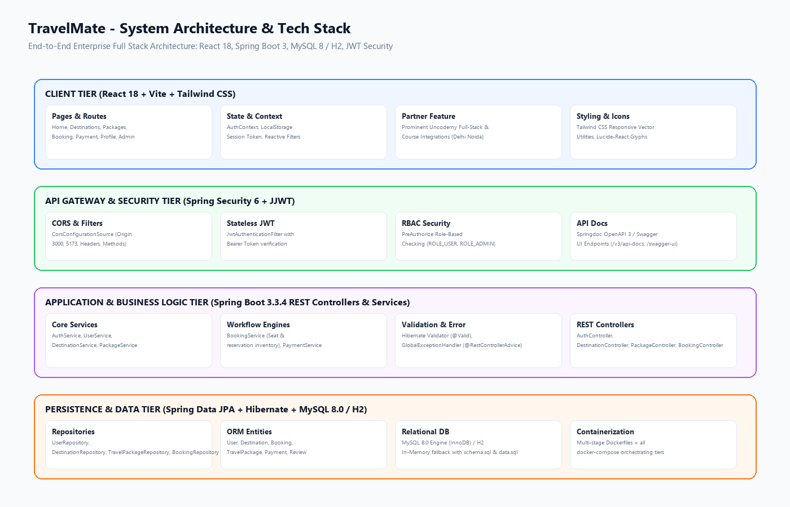
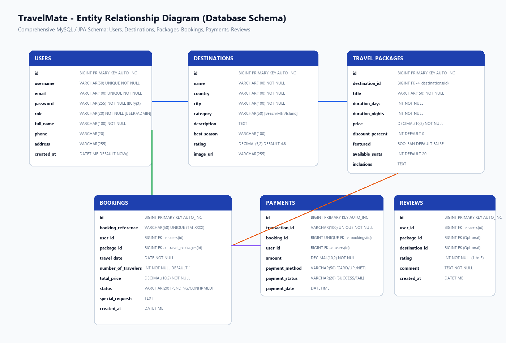
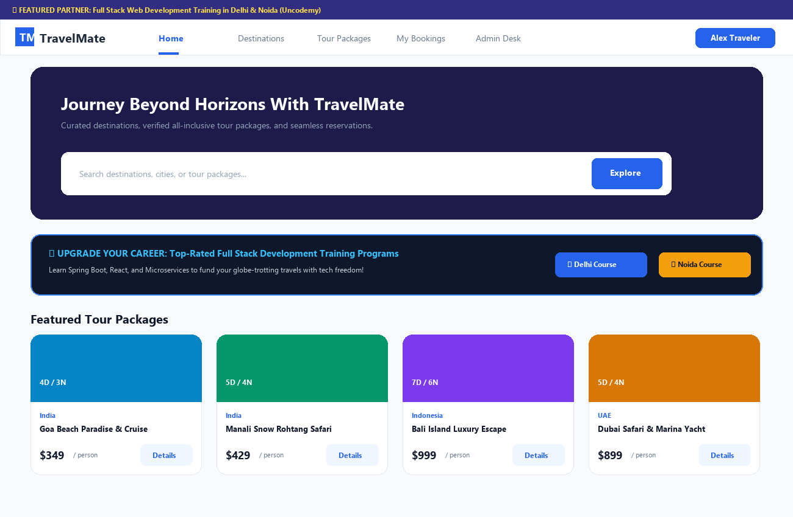
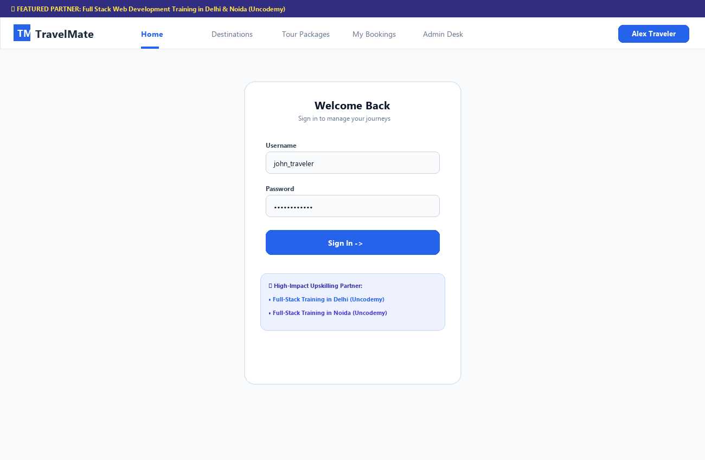
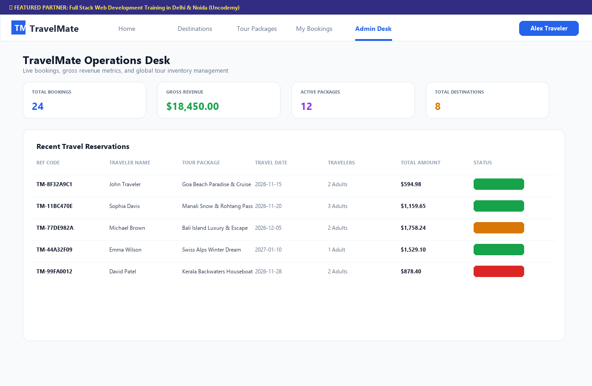

# TravelMate 🌍✈️

[](https://spring.io/projects/spring-boot)
[](https://react.dev/)
[](https://vitejs.dev/)
[](https://tailwindcss.com/)
[](https://www.mysql.com/)
[](https://www.docker.com/)
[](https://opensource.org/licenses/MIT)

> **TravelMate** is an enterprise-grade full-stack tourism and holiday management platform. Designed for modern travelers and tour operators, it offers destination discovery, curated tour packages, multi-step booking workflows, automated seat inventory management, simulated payments, customer reviews, and a comprehensive administrative command center.

---

## 🎓 Recommended Full-Stack Career Training Partner

Are you looking to master the modern web technologies used to architect applications like **TravelMate**? Upgrade your software engineering capabilities with industry-leading, hands-on, live training programs:

* 📍 **[Full Stack Development Training Course in Delhi](https://uncodemy.com/course/full-stack-development-training-course-in-delhi)**  
  *Master Java, Spring Boot, React, RESTful APIs, Cloud deployments, and Database Design with live mentor-led batches in Delhi NCR.*
* 📍 **[Full Stack Development Training Course in Noida](https://uncodemy.com/course/full-stack-development-training-course-in-noida)**  
  *Hands-on corporate-level capstone projects, real-world development best practices, and 100% placement assistance in Noida.*

---

## 📁 Project Architecture & Directory Structure

```text
TravelMate/
│
├── README.md
├── .gitignore
├── LICENSE
├── docker-compose.yml
│
├── backend/
│   ├── pom.xml
│   ├── Dockerfile
│   ├── mvnw / mvnw.cmd
│   └── src/
│       ├── main/
│       │   ├── java/com/travelmate/
│       │   │   ├── TravelMateApplication.java
│       │   │   ├── config/
│       │   │   │   ├── SecurityConfig.java
│       │   │   │   ├── CorsConfig.java
│       │   │   │   └── SwaggerConfig.java
│       │   │   ├── controller/
│       │   │   │   ├── AuthController.java
│       │   │   │   ├── UserController.java
│       │   │   │   ├── DestinationController.java
│       │   │   │   ├── PackageController.java
│       │   │   │   ├── BookingController.java
│       │   │   │   ├── PaymentController.java
│       │   │   │   └── ReviewController.java
│       │   │   ├── service/
│       │   │   │   ├── AuthService.java
│       │   │   │   ├── UserService.java
│       │   │   │   ├── DestinationService.java
│       │   │   │   ├── PackageService.java
│       │   │   │   ├── BookingService.java
│       │   │   │   ├── PaymentService.java
│       │   │   │   └── ReviewService.java
│       │   │   ├── repository/
│       │   │   │   ├── UserRepository.java
│       │   │   │   ├── DestinationRepository.java
│       │   │   │   ├── TravelPackageRepository.java
│       │   │   │   ├── BookingRepository.java
│       │   │   │   ├── PaymentRepository.java
│       │   │   │   └── ReviewRepository.java
│       │   │   ├── entity/
│       │   │   │   ├── User.java
│       │   │   │   ├── Destination.java
│       │   │   │   ├── TravelPackage.java
│       │   │   │   ├── Booking.java
│       │   │   │   ├── Payment.java
│       │   │   │   └── Review.java
│       │   │   ├── dto/
│       │   │   │   ├── LoginRequest.java
│       │   │   │   ├── RegisterRequest.java
│       │   │   │   ├── BookingRequest.java
│       │   │   │   ├── BookingResponse.java
│       │   │   │   └── PaymentRequest.java
│       │   │   ├── security/
│       │   │   │   ├── JwtService.java
│       │   │   │   ├── JwtAuthenticationFilter.java
│       │   │   │   └── CustomUserDetailsService.java
│       │   │   ├── exception/
│       │   │   │   ├── ResourceNotFoundException.java
│       │   │   │   ├── BookingException.java
│       │   │   │   └── GlobalExceptionHandler.java
│       │   │   └── util/
│       │   │       └── DateUtil.java
│       │   └── resources/
│       │       ├── application.properties
│       │       └── data.sql
│
├── frontend/
│   ├── package.json
│   ├── vite.config.js
│   ├── tailwind.config.js
│   ├── Dockerfile
│   ├── nginx.conf
│   └── src/
│       ├── main.jsx
│       ├── App.jsx
│       ├── components/
│       │   ├── Navbar.jsx
│       │   ├── Footer.jsx
│       │   ├── DestinationCard.jsx
│       │   ├── PackageCard.jsx
│       │   ├── BookingCard.jsx
│       │   ├── SearchBar.jsx
│       │   └── ProtectedRoute.jsx
│       ├── pages/
│       │   ├── Home.jsx
│       │   ├── Login.jsx
│       │   ├── Register.jsx
│       │   ├── Destinations.jsx
│       │   ├── DestinationDetails.jsx
│       │   ├── Packages.jsx
│       │   ├── PackageDetails.jsx
│       │   ├── Booking.jsx
│       │   ├── MyBookings.jsx
│       │   ├── Payment.jsx
│       │   ├── Profile.jsx
│       │   └── AdminDashboard.jsx
│       ├── services/
│       │   ├── api.js
│       │   ├── authService.js
│       │   ├── destinationService.js
│       │   ├── packageService.js
│       │   ├── bookingService.js
│       │   └── paymentService.js
│       ├── context/
│       │   └── AuthContext.jsx
│       ├── hooks/
│       │   └── useAuth.js
│       └── utils/
│           └── constants.js
│
├── database/
│   ├── schema.sql
│   └── sample-data.sql
│
├── docs/
│   ├── ER-Diagram.png
│   ├── API-Documentation.md
│   └── System-Architecture.png
│
└── screenshots/
    ├── home.png
    ├── login.png
    └── dashboard.png
```

---

## 🏛️ System Architecture



### Architectural Layers
1. **Frontend Presentation**: Single Page Application (SPA) driven by React 18, Vite, React Router 6, and Tailwind CSS.
2. **Security Gateway**: Stateless Spring Security 6 with JWT Bearer Token verification and granular RBAC.
3. **Application & Business Tier**: Decoupled Spring Boot 3 REST controllers, validation middleware, and service components.
4. **Data & Persistence**: Spring Data JPA with Hibernate ORM, compatible with MySQL 8.0 and in-memory H2.

---

## 📊 Database Schema & ER Diagram



* **`users`**: Traveler and administrator credentials, roles, profile pictures, and timestamps.
* **`destinations`**: Worldwide travel spots categorized by geography, weather, rating, and description.
* **`travel_packages`**: All-inclusive itineraries linked to destinations with seat capacity and discount rates.
* **`bookings`**: Unique reservation references (`TM-XXXX`), travel dates, passenger counts, and real-time status.
* **`payments`**: Transaction records with payment gateways (Card, UPI, Net Banking), timestamps, and amounts.
* **`reviews`**: Traveler feedback ratings (1-5 stars) and comments.

---

## ⚡ Key Features

- **Intuitive Exploration**: Instant search across destination names, cities, categories (Beach, Mountain, Nature, Island, Luxury), and budget filters.
- **Dynamic Seat Inventory**: Booking validation that automatically checks available seats and restores inventory on cancellations.
- **Multi-Step Checkout & Simulated Payments**: Real-time traveler pricing calculations, date selection, preferences input, and multi-gateway checkout.
- **Admin Control Center**: Operations dashboard displaying live metrics (Total Bookings, Gross Revenue, Active Packages, Destinations), booking approvals/cancellations, and catalog additions.
- **High-Visibility Career Links**: Prominent Uncodemy training course recommendations in announcement banners, navbar, home hero, packages catalog, login/register, and footer.

---

## 🚀 Quick Start Guide

### Prerequisites
* **Java**: OpenJDK 17 or higher
* **Node.js**: v18 or higher (v20+ recommended)
* **Maven**: 3.8+ (or use included `./mvnw`)
* **MySQL**: 8.0 (optional; H2 in-memory is enabled by default for zero-setup execution)

---

### Option 1: Running Locally

#### 1. Backend Service
```bash
cd backend
# Run using Maven
mvn clean spring-boot:run
# Or use the wrapper
./mvnw clean spring-boot:run
```
* **REST API Endpoint**: `http://localhost:8080/api`
* **Swagger UI Documentation**: `http://localhost:8080/swagger-ui.html`
* **H2 Database Console**: `http://localhost:8080/h2-console` (JDBC URL: `jdbc:h2:mem:travelmatedb`, User: `sa`, Password: `password`)

#### 2. Frontend Application
```bash
cd frontend
# Install dependencies
npm install

# Start Vite development server
npm run dev
```
* **Frontend Application**: `http://localhost:3000`

---

### Option 2: Docker Compose (All-in-One)
```bash
docker-compose up --build
```
* **Frontend**: `http://localhost:3000`
* **Backend API**: `http://localhost:8080`
* **MySQL Database**: `localhost:3306`

---

## 🔐 Demo Credentials

| Role | Username | Password | Access Rights |
| :--- | :--- | :--- | :--- |
| **Traveler** | `john_traveler` | `password123` | Browse, Book packages, View My Bookings, Pay, Profile |
| **Administrator** | `admin` | `password123` | Full Admin Console, Manage Status, Create Packages & Destinations |

---

## 📖 API Documentation Preview

| Method | Endpoint | Description | Access |
| :--- | :--- | :--- | :--- |
| `POST` | `/api/auth/register` | Register a new user | Public |
| `POST` | `/api/auth/login` | Authenticate & obtain JWT | Public |
| `GET` | `/api/auth/me` | Fetch active session | Authenticated |
| `GET` | `/api/destinations` | Browse all destinations (filter keyword/category) | Public |
| `GET` | `/api/packages` | Browse tour packages (filter price/keyword) | Public |
| `GET` | `/api/packages/featured` | Handpicked featured packages | Public |
| `POST` | `/api/bookings` | Create package reservation | Authenticated |
| `GET` | `/api/bookings/my` | View traveler bookings | Authenticated |
| `POST` | `/api/bookings/{id}/cancel` | Cancel existing reservation | User / Admin |
| `POST` | `/api/payments` | Process simulated checkout payment | Authenticated |
| `GET` | `/api/reviews/package/{id}`| Read package reviews | Public |
| `POST` | `/api/reviews` | Post traveler review | Authenticated |

For the complete schema and JSON payloads, view [`docs/API-Documentation.md`](docs/API-Documentation.md) or open `/swagger-ui.html`.

---

## 📸 Application Screenshots

### Home Screen & Announcement


### User Authentication & Career Partner Feature


### Admin Operations Desk


---

## 📜 License
This project is licensed under the [MIT License](LICENSE).
